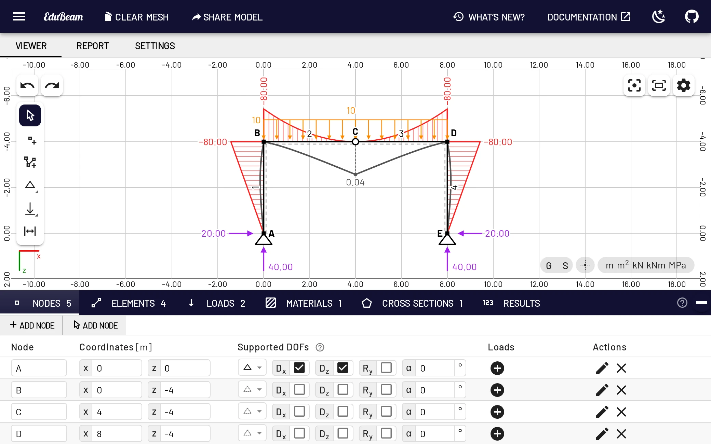
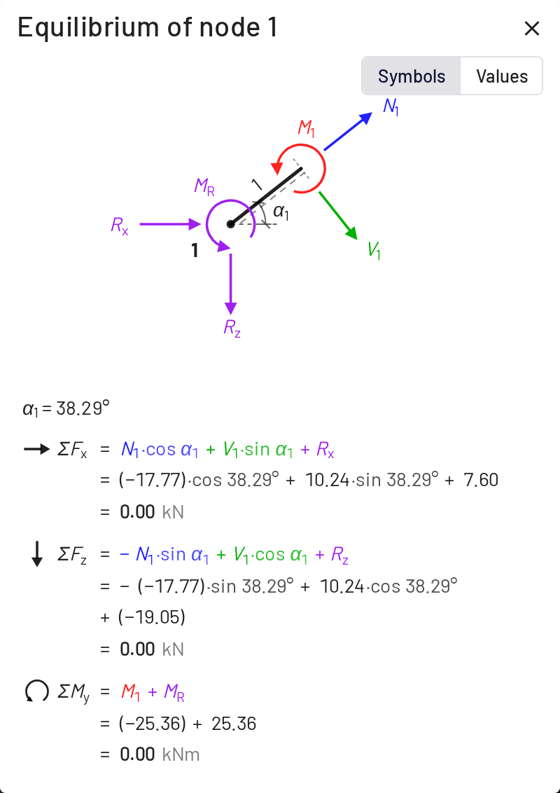
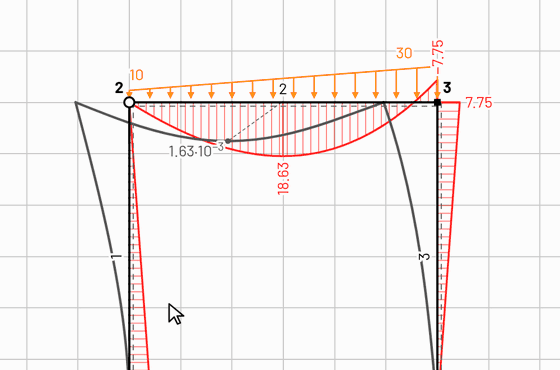
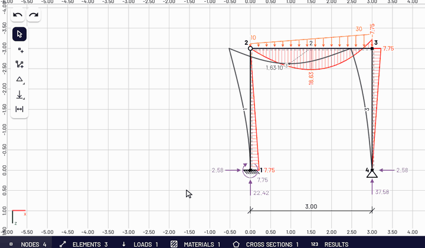
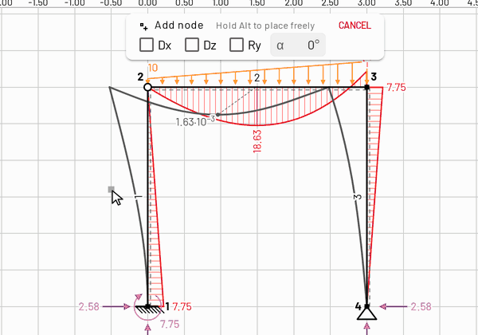
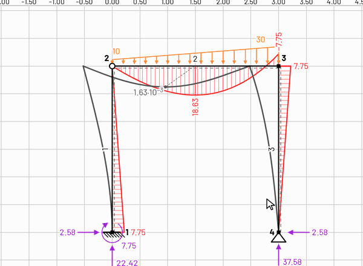
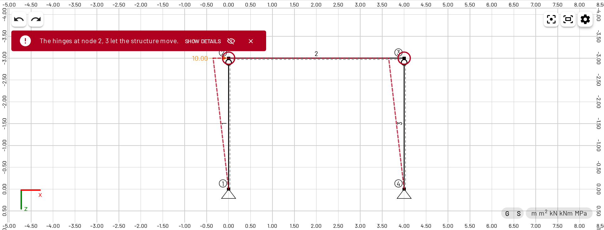
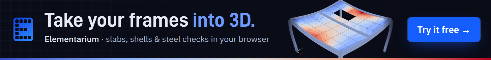

<p align="center">
  <a href="https://run.edubeam.app">
    
  </a>
</p>

<h1 align="center">EduBeam</h1>

<p align="center">
  <strong>Structural analysis of beams, frames and trusses, in the browser.</strong><br>
  Draw a structure, load it, and read its reactions, internal forces and deflection as you go.<br>
  Free, open source, nothing to install. Made by civil engineers who teach.
</p>

<p align="center">
  <a href="https://run.edubeam.app"><strong>Open EduBeam</strong></a> ·
  <a href="https://run.edubeam.app/?panel=examples">Examples</a> ·
  <a href="https://www.edubeam.app/guide/quick-start">Guide</a> ·
  <a href="https://www.edubeam.app/guide/teaching">For teachers</a>
</p>

<p align="center">
  
  
  
  
</p>

<p align="center">
  <a href="https://run.edubeam.app">
    <picture>
      <source media="(prefers-color-scheme: dark)" srcset=".github/readme/hero-dark.webp">
      
    </picture>
  </a>
</p>

EduBeam solves plane structures as you build them. Add nodes and members, put in supports and loads, and the
deformed shape, the reactions and the N, V and M diagrams are on screen at once. Change anything and the results
follow. It runs entirely in your browser, and your models stay on your computer.

It is made for learning: students can try "what if?" as fast as they can click, and a teacher can put a live model
in front of a class, or in every student's hands, with a link.

## Features

**Model**

- Beams, frames and trusses together, with Timoshenko beams (shear deformation included), end hinges, rotated
  supports and prescribed displacements.
- Point loads and moments, uniform and trapezoidal distributed loads, settlements, and uniform or gradient temperature.
- Supports and loads straight from the toolbar, snapping to nodes, midpoints and thirds, and loads you drag to move.
- Your own cross section: pick a preset or draw any polygon, holes included, and get its area, moments of inertia
  and principal axes.

**Understand the results**



- Diagrams whose values never overlap, and the values of N, V, M and the deflection wherever you point.
- **Node equilibrium**: cut a joint free and see its forces and their sums, in symbols or in values.
- A model that won't solve is explained: EduBeam circles the hinges or supports that let it move and animates the
  motion.
- Every element's stiffness matrix and degrees of freedom, and [hand calculations](https://www.edubeam.app/guide/verification)
  to check the numbers against.

<br clear="right">

**Share and export**

- The **Report** tab: loads, internal forces and deflection, ready to print.
- SVG for Word, LaTeX and Inkscape, PNG at any size, CSV for spreadsheets, and a readable `project.json`.
- Mouse, keyboard or touch; SI or US units; z-down or y-up axes; light or dark; 18 languages.

<table>
  <tr>
    <td width="50%"></td>
    <td width="50%"></td>
  </tr>
  <tr>
    <td align="center"><sub>Values at the pointer</sub></td>
    <td align="center"><sub>Loads from the toolbar</sub></td>
  </tr>
  <tr>
    <td width="50%"></td>
    <td width="50%"></td>
  </tr>
  <tr>
    <td align="center"><sub>Snapping</sub></td>
    <td align="center"><sub>Drag a load</sub></td>
  </tr>
  <tr>
    <td colspan="2"></td>
  </tr>
  <tr>
    <td colspan="2" align="center"><sub>Too many hinges? EduBeam shows which ones, and how the structure would move.</sub></td>
  </tr>
</table>

New to EduBeam? The welcome screen offers **Draw your first beam**, a short guided task from the first node to the
first bending moment.

## In the classroom

- **A model is a link.** _Share model_ puts the whole model in the URL: no accounts, no uploads. Every student who
  opens it gets their own copy, and the link opens the same model years later.
- **In your slides and notes.** Add `viewer=1` for a clean, read-only model to embed:
  ```html
  <iframe src="https://run.edubeam.app/?viewer=1&model=…" width="100%" height="400"></iframe>
  ```
- **In your students' language.** Add `lang=` with `cs`, `de`, `es`, `fr`, `it`, `pl`, `pt`, `ru`, `uk`, `tr`,
  `cn`, `ja`, `ko`, `hi`, `id`, `th` or `vi`.
- **Assignments as files.** <kbd>Ctrl</kbd>+<kbd>S</kbd> saves a plain JSON `project.json`, easy to generate or check
  with a script: see the [file format](https://www.edubeam.app/essentials/import-export).
- **Practice and tests.** [Practice](https://www.edubeam.app/practice) gives a new beam, frame or truss with fresh
  numbers and checks the answers; the [exam builder](https://www.edubeam.app/exam) prints a different test for every
  student, with an answer key.
- **Figures from code.** [@edubeam/plot](https://www.edubeam.app/plot) draws any solved structure in your own slides
  and notes. See it in an [example lecture on trusses](https://edubeam-slides.pages.dev).

Work is saved in the browser as you go, and _Recent structures_ brings back the last models you cleared.

## The EduBeam family

| Project | What it is |
| --- | --- |
| [**EduBeam**](https://run.edubeam.app) | This app. |
| [**www.edubeam.app**](https://www.edubeam.app) | The guide in 18 languages, practice, exams, and the libraries' docs ([source](https://github.com/EduBeamApp/web)). |
| [**@edubeam/fem**](https://github.com/EduBeamApp/fem) | The finite element solver behind EduBeam, in TypeScript. |
| [**@edubeam/plot**](https://github.com/EduBeamApp/plot) | Vue components that draw structures and their results as SVG, for your own pages and slides. |
| [**EduBeam slides**](https://github.com/EduBeamApp/slides) | An example lecture made with @edubeam/plot and Slidev ([live](https://edubeam-slides.pages.dev)). |
| [**Elementarium**](https://elementarium.app/?utm_source=edubeam&utm_medium=link&utm_campaign=readme) | Our sibling app for 3D: frames, slabs, shells and steel checks. |

<a href="https://elementarium.app/?utm_source=edubeam&utm_medium=banner&utm_campaign=leaderboard&utm_content=readme">
  
</a>

## Development

You need Node.js 20 or newer (CI uses 22).

```bash
git clone https://github.com/janvorisek/edubeam.git
cd edubeam
npm install
npm run dev          # http://localhost:5173
```

| Command | What it does |
| --- | --- |
| `npm run dev` | The dev server, with hot reload |
| `npm run build` | The app, built into `dist/` |
| `npm test` / `npm run test:run` | The tests, in watch mode / once |
| `npm run lint` / `npm run lint:fix` | ESLint on `src/` / and fix what it can |
| `npm run contributors` | Who has contributed since the last release |

It is Vue 3 with Vuetify and Pinia, in TypeScript; the solver is [@edubeam/fem](https://github.com/EduBeamApp/fem)
and the new drawing [@edubeam/plot](https://github.com/EduBeamApp/plot).

```
src/
  views/Editor.vue      the editor: drawing, tables and panels
  components/           the viewer, context menus, dialogs, settings, widgets
  store/                Pinia stores: project (the model), viewer, layout, app settings, clipboard
  CommandManager.ts     undo and redo: every edit of the model goes through it
  locales/              the interface in 18 languages, one JSON file each
  tests/                Vitest specs
public/changelog/       the release notes shown in the app, and their pictures
```

[AGENTS.md](AGENTS.md) has the project's conventions: units, axes, undo, translations, and why old share links and
files must always keep working.

### Building and hosting

`dist/` is a static site that can be hosted anywhere. Optional environment variables, in `.env`:

| Variable | What it's for |
| --- | --- |
| `VITE_BASE` | Serve the app from a subpath, e.g. `/edubeam/`, with the trailing slash. Without it, an app in a subfolder looks for its assets, manifest and service worker at the root of the domain. |
| `VITE_GANALYTICS_TAG_ID` | A Google Analytics tag. Without it, analytics stays off. |
| `SENTRY_AUTH_TOKEN` | Uploads source maps to Sentry during the build. |

Our own copy deploys on push: `main` to [run.edubeam.app](https://run.edubeam.app), `dev` to a preview.

## Contributing

You don't have to write code to help. Bug reports, example models, translations and stories of how you use EduBeam
in your classes are all welcome.

- **Found a bug?** [Open an issue](https://github.com/janvorisek/edubeam/issues), with a screenshot or a share link.
- **Sending code?** Branch from `dev`, run `npm run test:run` and `npm run lint`, and open a pull request against
  `dev`. Small, focused changes are the easiest to review; for a change to the interface, add before and after
  screenshots.
- **Translating?** The interface is in [`src/locales/`](src/locales), with [`en.json`](src/locales/en.json) as the
  source; the guide is part of the [website](https://github.com/EduBeamApp/web).

EduBeam speaks English, Czech, German, Spanish, French, Italian, Polish, Portuguese, Russian, Ukrainian, Turkish,
Chinese, Japanese, Korean, Hindi, Indonesian, Thai and Vietnamese. Thanks to everyone who helped get it there.

## License

EduBeam is free software under the [GPL-3.0](LICENSE).
